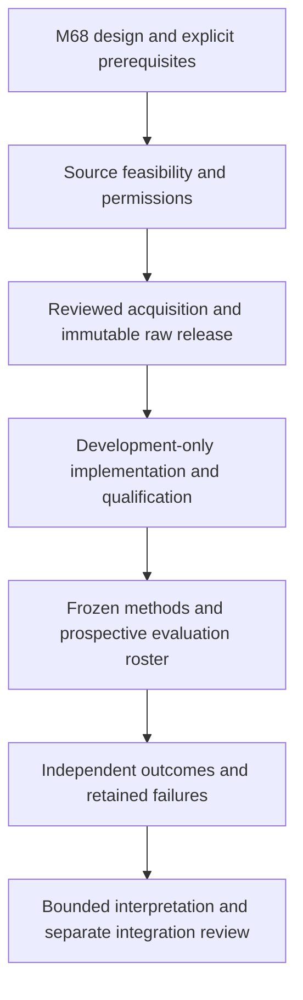

# Mission 68 — Observation-Utility Calibration Study Design

**This mission defines a study; it does not establish calibrated observing
performance.** The first proposed question is whether AstroScope's unchanged
weather score contains predictive information about delivery of a usable image
under one explicitly specified observing task. No observational dataset has been
acquired, no calibration model fitted and no new scientific result generated.
The design is submitted for review; execution readiness is **blocked**.

[Mission 67](validation/frozen_scheduler_evaluation.md) was merged through
[PR #67](https://github.com/wolfchil345/astroscope-ai-observatory/pull/67) at
`3fd937baca1e78c24d3d6a3a637b19a963251d6e`. Its three post-merge workflows passed
with 10,201 tests and 26 historical expected failures. All 32 downloaded archives
were checked, including all 1,344 scheduler records and the 16,133-event replay
journal; see the [merge receipt](evidence/mission67_merge_ci_v1.json).
P3-E03/P3-E04 are accepted within that finite study. The original first-exposure
record, prior ledgers and all production/scientific files remain unchanged.

The [machine-readable design](protocols/observation_utility_v1.json),
[data contract](protocols/observation_utility_data_contract_v1.md),
[source review](evidence/observation_utility_sources_v1.json) and
[scope ledger](evidence/observation_utility_design_v1.json) accompany this report.
The version freezes this design for review, **not a runnable preregistration**:
site, instrument, quality thresholds, dates and precision requirements cannot be
honestly filled without the next feasibility work.

## Question, estimand and relationship to the roadmap

For a roster of imaging opportunities registered before their forecasts/outcomes
are inspected, does a training-only mapping of the frozen weather score improve
probability forecasts of task delivery over a training-only constant baseline?
An opportunity is one predeclared exposure request with a fixed target/field,
instrument configuration, filter, duration and UTC start/end tolerance. The first
study is restricted to one site and instrument configuration. Repeated frames,
targets and forecast horizons are not independent replications.

The primary outcome is **delivery of an image meeting a fixed quality contract**,
including the actual operating policy's cancellations. It is not pure atmospheric
quality, arbitrary science value, transit detection, scheduler benefit or safe
hardware operation. Retrospective, policy-selected archives can support a
descriptive feasibility study; without the full predecision roster and verified
information availability they cannot become prospective evidence by relabelling. Study U0/U1/D0 predictions must remain
shadow outputs: operators and acquisition systems cannot use them to accept,
cancel or select opportunities. Freeze and disclose the existing operating policy
and any forecast-driven cancellations; delivery skill under that policy cannot
be reinterpreted as atmospheric skill or a causal improvement from scheduling.

| Existing quantity | Meaning retained | What this design permits |
|---|---|---|
| Planner total | Nominal altitude/airmass/Moon/darkness policy points | Record as an exploratory covariate; no probability interpretation |
| Weather score | Fixed weighted components and rain/gust caps | One proposed calibration predictor; no weight changes |
| Transit priority | Weighted policy score, with missing-value conventions | Excluded from the first imaging study; X01 remains blocked |
| M63–67 objective | Synthetic score sum minus nominal switch charges | Historical algorithm evidence only; not a measured utility label |
| Calibrated probability | Future estimated probability of this task's binary outcome | Research-only, conditional on evidence and later evaluation |

This is a bounded first step toward P3-E05. Planner, ranking, other tasks/sites,
forecast variables and policy comparisons require separate protocols. No Phase 4
AI implementation, production integration or Phase 3 exit is authorized here.



## Independent outcome contract

Define a success only when an independently processed, identifiable delivered
image satisfies **all** predeclared requirements: acquisition within the request's
time tolerance; correct configuration and exposure; calibrated, unsaturated target
measurement; signal-to-noise ratio at least `snr_min`; and detector PSF FWHM at
most `fwhm_max_arcsec`. Exact equality passes. Pipeline validity requirements,
reference stars, aperture/PSF algorithm, calibration frames, gain/read noise,
pixel scale, masks and uncertainty calculation must be frozen before evaluation.
SNR uses independently estimated net signal divided by its positive finite
standard uncertainty, in consistent units. No catalogue-predicted or heuristic
score-derived SNR can substitute for a measurement.

- **Y=1:** independently verified delivery and every required measurement passes.
- **Y=0:** verified cancellation/non-delivery, or a valid measurement demonstrably
  violates a required threshold. Preserve the failure reason, including weather,
  operator, tracking and instrument causes; do not remove non-weather failures.
- **Y=null:** evidence is absent, ambiguous, corrupt, or cannot decide the contract.
  Failure to compute a measurement is not automatically proof of scientific failure.
  If a conclusive failure is known, retain Y=0 even when other criteria are unknown.

An independent reference pipeline must read raw images/calibrations/logs, not
AstroScope scores, labels or recommendations. The source for each measurement,
its uncertainty and the adjudication history must remain inspectable. Conflicts
between independent reductions are retained as unresolved until resolved using
the frozen adjudication policy. Independent code is not independent human review;
any human review must identify the reviewer and conflicts of interest.

ESO's QC documentation [R1] distinguishes detector image quality from atmospheric
seeing and assesses observations against declared constraints. That motivates
measured task-specific outcomes here; its site/instrument rules, tolerances and
grades are not imported as AstroScope ground truth. The numerical thresholds
remain unset pending a scientific task and instrument-specific justification.

## Forecast provenance and the decision-time barrier

The primary horizon is fixed at **24 hours before the planned exposure start**.
Register the roster before forecast inspection. At the decision instant, retain
the actual response bytes and request, model/product/version, initialization time,
documented publication/availability evidence, capture time, valid-time semantics,
units, location/grid cell, elevation, transformations and SHA-256 checksums.
Initialization alone is not proof of publication or receipt. Require:

\[
t_{\mathrm{init}}\le t_{\mathrm{available}}\le t_{\mathrm{captured}}
\le t_{\mathrm{decision}}=t_{\mathrm{planned\ start}}-24\,\mathrm{h}.
\]

Pin one explicitly named model, not an undocumented changing best-match blend.
Use no revised forecast, reanalysis or observed meteorology as a predecision
predictor. The response may predict later valid times; the information itself
must already have been available. If the prerequisite fails, retain the row and
record predictor unavailability rather than substituting a convenient later run.

Open-Meteo documents stitched historical forecasts [R2] and separately addressable
individual runs [R3]. A run archive can support initialization/lead matching; it
does not by itself prove historical end-user availability. R2/R3 are provider
documentation reviews only: no payload or archive coverage has been acquired or
qualified. Apparent documentation coverage dates are not an acquisition receipt.

The input mapping must specify the valid-time sample for each weather variable,
whether it is instantaneous or an accumulated/averaged interval, and any spatial
or temporal transform. No interpolation of unknowns or inference that a point
forecast covers an entire exposure is allowed. Freeze this mapping and maximum
age/tolerance in the acquisition release. Preserve the strict UTC/civil-time
contracts from Missions 25–32; no implicit DST fold or gap adjustment.

## Frozen proposed methods and metrics

These are specifications only. They do not train or alter the scheduler.

| ID | Proposed forecast | Training and missingness rule |
|---|---|---|
| U0 | Constant probability `(k+1)/(n+2)` | k and n are night-weighted success/total counts; both classes required by the readiness plan |
| U1 | Fixed weather-score bins `[0,20),[20,40),[40,60),[60,80),[80,100]`; probability `(k_b+1)/(n_b+2)` | Training only, no bin search or monotonicity constraint; fewer than 20 distinct resolved training nights in a bin falls back to U0 |
| D0 | Raw weather score divided by 100 | Diagnostic naive probability only; not assumed calibrated and not a primary competitor |

For fitting, let `m_d` be the number of resolved training opportunities in night
`d` and give each such row weight `1/m_d`. Define `n=sum(w_i)` and
`k=sum(w_i*y_i)` across resolved training rows; for a bin use the same row
weights restricted to that bin. Thus the pseudo-counts in the formulas are
night-equivalent weights. A night with no resolved outcome supplies no fitting
weight and remains in the missingness report. Bin support counts **distinct
nights**, not repeated frames. This matches the intended night-balanced target
more closely than letting dense acquisition nights dominate training; missing
training labels still limit representativeness.

Missing/invalid/unavailable weather predictors cause **U1=U0**, with a distinct
reason code, preserving the full roster denominator. D0 is null on such rows and
its coverage is separately reported. The fixed bin-support floor and smoothing
are project design choices, not empirical findings or a power guarantee. U0 and
bin estimates use resolved training labels only; report training missingness and
do not silently assume it is random. No evaluation label may affect fitting,
binning, fallback, choice of model or weights. Do not refit after development
review on an undisclosed combined split.

For resolved outcomes, the Brier loss and paired improvement statistic are

\[
L(p,y)=(p-y)^2,\qquad d_i=L(p_{U1,i},y_i)-L(p_{U0,i},y_i).
\]

The primary estimand is the **night-balanced mean**: average opportunity losses
within each registered night with at least one roster entry, then average those
night means. A crowded night cannot dominate the study. Report exposure-weighted
values separately, with counts. The Brier rule evaluates probabilities [R4]; a
better score alone does not establish calibration, causal benefit or universal
utility. Also report fixed predicted-probability bins at 0.2 intervals, mean
prediction, observed frequency, known/unknown counts and dependence-aware
intervals; include all bins, including empty ones. Reliability diagnostics are
not a substitute for the primary paired comparison.

For every unknown outcome use both possible binary labels. Retain
`min(d_i(0),d_i(1))` and `max(d_i(0),d_i(1))`, and aggregate with the **same full
roster/night weights** to bound the cohort's paired difference without assuming
missing-at-random. Similarly bound each method's Brier loss. Complete-case
results are secondary. Known zero is not missing; verified non-delivery is not
deleted; absent files do not justify a zero. Record outcome and predictor
missingness separately by split, night, score bin and reason.

## Prospective splits, uncertainty and stopping

Use chronological **training → development → sealed evaluation** intervals with
a predeclared purge gap. All frames/reductions of an opportunity, the same night,
and any shared calibration/forecast lineage that can transmit fitted information
must stay in one split or be purged. Independent fixed external reference assets
may be shared only with their role explicitly recorded. Training establishes U0
and U1; development qualifies implementations and inference; the final future
evaluation fixes both methods. Cross-boundary groups cannot be split for count
convenience. Temporal evaluation is motivated by [R5]; it does not remove drift.

Exact dates, grouping keys, purge duration and embargo/access custodian must be
set in a separately reviewed release before any evaluation outcomes are inspected.
If outcomes already exist or have been inspected, disclose this and call the
evidence retrospective/exposed; a public archival split is not a blind study.
Record UTC access events, actor/process, purpose, object hashes and exposure state.
An accidental reveal freezes the incident and closes the unseen-evidence claim.

The proposed uncertainty method is a **paired moving-block bootstrap of calendar
nights**, resampling identical time blocks for U0/U1 and all missingness bounds.
Keep opportunities within nights together, preserve empty calendar nights in
the block timeline, and compute the night-balanced mean over roster-bearing
nights in each replicate. Blocks never wrap across the end, cross different
setups, or bridge excluded campaign gaps. Define the admissible block starts,
block length, truncation/weighting, replicate count, RNG algorithm/seed,
quantile convention and zero-denominator handling in the inference release.
The methods stay fitted to training during evaluation resampling; intervals are
conditional on those fitted methods, not total training/model uncertainty.

Dependence, seasonality and nonstationarity must be assessed using development
data. Time-series bootstrap validity is conditional and finite-sample performance
can be poor [R6]. Require development-only interval-coverage controls under
declared dependence/drift/missingness scenarios before choosing an inference
configuration. If its assumptions or minimum independent information are not
supported, report finite-cohort descriptive results and label generalizing
inference **unqualified**. Do not pretend a nominal 95% interval guarantees
coverage for arbitrary weather histories.

Before evaluation, freeze the calendar end, opportunity roster/count rule,
minimum nights/class support, missingness/coverage limits, effect margin `delta`,
maximum interval width and inference qualification criteria. These are currently
**null blockers**, not defaults. A scientific acceptance claim would require all
readiness and integrity gates, qualified uncertainty, and an upper 95% bound for
the missingness-worst-case paired mean below `-delta` with sufficient precision.
Report failure, inconclusiveness and negative skill without changing thresholds.
Skill acceptance permits only a bounded predictive comparison; calibration needs
the separately predeclared reliability tolerances and simultaneous-interval rule.
Neither would authorize production use.

Stop at the frozen end/count rule without inspecting effect estimates to extend
the run. A shortfall is incomplete. Unqualified labels, integrity faults,
information leakage, unsupported timestamps or instrument/model drift stop the
affected claim; retain all raw evidence and denominators. Versioned repairs keep
the original failure, disclose exposure and use a separately approved future
evaluation for any new confirmatory claim. No rerolls or quiet case removal.

## Readiness gates and deliverables

| Gate | Required evidence | Current status |
|---|---|---|
| U68-G01 Task and cohort | Site/setup, target roster, task contract, acquisition policy | Blocked: not selected |
| U68-G02 Rights and provenance | Lawful acquisition/redistribution, raw products, forecast availability | Blocked: no dataset qualified |
| U68-G03 Independent labels | Pipeline, calibration references, error model, adjudication | Blocked: no labels generated |
| U68-G04 Prospective access | Exact splits/gap/roster and audit mechanism | Blocked: dates/custodian unset |
| U68-G05 Inference | Sample/precision/effect plan, dependency and coverage qualification | Blocked: no development evidence |
| U68-G06 Offline reproducibility | Frozen raw release, environment, implementations, independent controls | Specified, not implemented |
| U68-G07 Evaluation and review | Complete future results, adverse outcomes, qualified bounded claims | Not started |

The machine-readable design lists each unresolved field and the evidence needed
to close it. No scientific execution may start while one remains unresolved.
Design acceptance does not close these gates. The data contract lists 18 future
control cases; this mission's documentary mutations are separate from those
unimplemented scientific controls.

The eventual offline package must contain legally distributable raw bytes or an
explicit restricted-data limitation, immutable acquisition manifests, all
transformations, source commits, exact dependency/environment identity, independent
reference provenance, full rejected/unknown/cancelled rows and an append-only
access journal. Offline analysis must reject network access and hash mismatches.
Reproduction requires both outputs and rejection decisions. A package lacking
necessary raw inputs cannot claim unrestricted offline reproducibility.

Run the stdlib-only documentary check from a checkout with baseline Git history:

```bash
python docs/research/evidence/verify_observation_utility_design.py
```

It checks structured scope/readiness, precursor receipts, protected baseline
files, carried-forward restrictions, links and adversarial documentary mutations.
Local verification passed: 558 protected baseline files, seven mission-file
hashes, 95 relative links and 23 rejected documentary mutations. These counts
are documentary checks, not additional scientific trials.
It imports no scientific method and acquires no observations. Existing three CI
workflows, 10,201 tests, 26 historical xfails and 32 scientific artifacts are
preserved. All final-head workflows and downloaded archives must pass before PR
handoff; final receipts are recorded in the PR without altering historical records.

**Proposed Mission 69 — Observation-Utility Source Feasibility and Acquisition
Specification.** After M68 review/merge, assess candidate sources' schemas,
rights, completeness, temporal provenance and independent outcome support, then
prepare a concrete acquisition specification or documented no-go. No bulk data
acquisition, outcome evaluation, fitting or hardware control is included in that
proposal. Mission 69 has not started.

X01 retains 18 unestablished requirements, six unknown components, 48 unqualified
site clocks and 288 blocked / zero executed arrivals. Physical bounds remain null;
covariance is unacquired/unpropagated. The five M62 exclusions, 13/5/8 strict-transit
categories, M56's nine and M60's 17 historical failures and the M37 production
timing boundary remain intact. P3-E05/P3-E06 remain open; Phases 4–8 remain planned.

## Sources read for this design

The following primary sources were read on **2026-11-02 (JST)**. The linked
[source ledger](evidence/observation_utility_sources_v1.json) records applicability
and limits. The formulas, cohort and proposed gates above are AstroScope design
choices, not externally validated results. No source is queried during offline
documentary verification.

- **R1:** [ESO QC0 OB grading](https://www.eso.org/sci/facilities/paranal/quality-control/qc0-ob-grading.html),
  Basic policy and Image Quality/Transparency sections: measured constraints;
  instrument/site-specific context, not an AstroScope accuracy reference.
- **R2:** [Open-Meteo Historical Forecast API](https://open-meteo.com/en/docs/historical-forecast-api),
  introduction: stitched first forecast hours; not a full per-run forecast history.
- **R3:** [Open-Meteo Single Runs API](https://open-meteo.com/en/docs/single-runs-api),
  introduction and run parameter: individual initialization-time selection;
  actual historical availability and applicable coverage remain unverified.
- **R4:** Gneiting and Raftery (2007),
  [Strictly Proper Scoring Rules, Prediction, and Estimation](https://sites.stat.washington.edu/raftery/Research/PDF/Gneiting2007jasa.pdf),
  JASA 102, 359–378, section 3/example 1 (p. 363), DOI 10.1198/016214506000001437:
  proper probabilistic scoring; not a calibration guarantee for U1.
- **R5:** Cerqueira, Torgo and Mozetič (2020),
  [Evaluating time series forecasting models](https://kt.ijs.si/igor_mozetic/papers/CerTorMoz-TimeSer-MACH-20.pdf),
  Machine Learning 109, 1997–2028, sections 1–2, DOI 10.1007/s10994-020-05910-7:
  temporal performance-estimation caveats; not a universal splitting theorem.
- **R6:** Bühlmann (1999),
  [Bootstraps for Time Series](https://stat.ethz.ch/Research-Reports/87.pdf),
  ETH Research Report 87, introduction and block-bootstrap discussion:
  dependence-aware resampling and finite-sample limitations; does not qualify
  an unknown AstroScope cohort or choose its block length.
