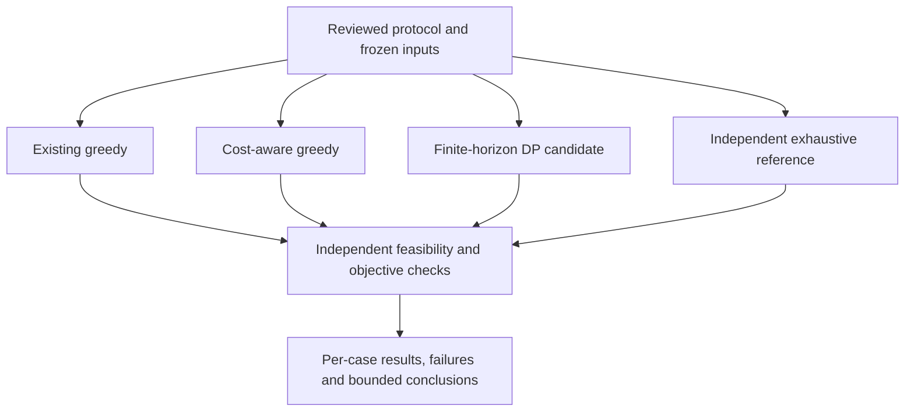

# Mission 63 — Phase 3 Entry Protocol and Observation-Optimisation Baseline Definition

**Phase 3 begins with a protocol, not an evaluated optimizer.** Mission 62 was
merged through [PR #62](https://github.com/wolfchil345/astroscope-ai-observatory/pull/62)
at `cbc054d1cd5cf65d9750137743c54c8d435ea114`. Its merge accepts the documented
**limited-scope** Phase 2 exit. The user's separate Mission 63 instruction
authorizes this entry work. The original pre-approval M62 ledger remains intact;
the [transition record](evidence/phase_3_entry_v1.json) records the later decision.

The [M62 merge-CI receipt](evidence/mission62_merge_ci_v1.json) records the
post-merge run, test totals and all 28 downloaded archive checks. Final Mission 63
CI and archive receipts belong to its PR and must pass before handoff.
This mission changes no production code, test, scientific fixture, canonical
result, numerical threshold or CI workflow. It adds no scientific result or
29th benchmark artifact. Protocol integrity checks do not count as science tests.

## Research question and claim boundary

For a single synthetic resource, known slot scores and eligibility masks, how
much surrogate objective is lost by independent per-slot greedy selection when
changing targets has a declared cost? Can a finite-horizon candidate reproduce
an independently enumerated optimum for precisely that finite problem?

The starting evidence is [Mission 55](validation/heuristic_characterisation.md):
the unchanged greedy scheduler ignores switch cost. Its published three-slot
control scores A = (90, 89, 90), B = (89, 90, 89) give greedy A→B→A, gross 270,
net 230 at cost 20, while A→A→A has net 269. These are retained M55 results,
not a new Mission 63 experiment or a defect in the existing production contract.

This first study isolates **selection on supplied inputs**. Scores are nominal
policy points, not probabilities, physical exposure value or calibrated science
yield. Eligibility applies to a complete synthetic slot by definition; it is not
inferred from an astronomical sample. All methods receive the same complete input
horizon, though greedy methods intentionally use only current-slot information.
An offline look-ahead advantage is not evidence of operational forecast skill.



## First experiment: exact finite problem

Let slots be indexed by \(t=0,\ldots,N-1\), targets by \(j=0,\ldots,M-1\),
and the idle action by \(\varnothing\). The executable recipe and reserved case
IDs are specified in the [protocol manifest](protocols/observation_optimisation_v1.json).
The manifest is a specification; the fixture generator and oracle do not yet exist.

| Item | Fixed convention |
|---|---|
| Resource and horizon | One resource, at most one target per slot; finite horizon, no overlapping tasks |
| Time | Explicit UTC start `2024-03-20T00:00:00Z`; equal 60-minute slots; half-open intervals, end excluded |
| Primary dimensions | N ∈ {3, 6, 9}, M ∈ {2, 3}; separate boundary controls allow N=1 and M=0/1 |
| Score q(t,j) | Integer 0–100 or null; zero is known zero, null is missing; no implicit prior or fitted weight |
| Eligibility e(t,j) | true, false or null; only literal true with a known score permits observation |
| Idle | Always feasible, zero reward; it retains the last observed target |
| Target identity | Exact ASCII IDs `target_00`, …; canonical ascending order, then idle last |
| Switching cost λ | Integer policy points per change, profiles {0, 5, 20}; not slew seconds or a measured cost |
| Initial/terminal state | No initial target, first acquisition free, no terminal reward/charge |
| Physical quantities | No real target coordinates, weather forecast, telescope slew, exposure or calibration model |

Let \(\ell_t\) be the last **non-idle** target before slot \(t\), initially
\(\bot\). For idle, \(\ell_{t+1}=\ell_t\); for observation \(j\),
\(\ell_{t+1}=j\). Define

\[
K(a)=\sum_{t=0}^{N-1}
\mathbf1\{a_t\ne\varnothing,\ \ell_t\ne\bot,\ a_t\ne\ell_t\},
\qquad
J(a)=\sum_{t:a_t\ne\varnothing}q(t,a_t)-\lambda K(a).
\]

Thus A→idle→B still pays one change; A→idle→A pays none. Idling cannot erase
history to avoid a charge. Every method is scored using this same rule. Idle is
allowed even when a target is available. Negative heuristic net values are retained;
the feasible all-idle path ensures the finite optimum is at least zero.
No cross-cadence or continuous-time utility comparison is made in this protocol.

The sufficient state is `(slot, last_non_idle_target)`: future inputs are fixed,
and the only path dependence is the next change charge. A candidate backward
recurrence is

\[
V_N(\ell)=0,\qquad
V_t(\ell)=\max_{a\in A_t}
\left[r_t(\ell,a)+V_{t+1}(f(\ell,a))\right],
\]

where \(A_t\) contains idle and eligible known-score targets, \(f\) is the state
update above, idle reward is zero, and observation reward subtracts the specified
change charge. Terminal zero and backward induction cover the finite paths: for
each feasible first action, the same sufficient state defines the remaining
subproblem; maximizing its optimal tail covers all feasible completions. This is
our model-specific argument, not an implementation acceptance result. The
finite-horizon/state-augmentation method follows Bertsekas [R1]. Its nominal
work is O(N(M+1)²), with O(N(M+1)) value/policy storage if all layers are retained.
Neither complexity nor the recurrence proves that future code is correct.

## Baselines, adapter and independence

| ID | Definition | Required future check |
|---|---|---|
| B0 | Execute unchanged `calculate_observation_schedule_strict` with controlled planner results; choose highest score, then altitude, then input order; idle only if no recommendation | Reproduce the source policy and retained M55 controls; do not retrofit switching costs |
| B1 | Maximize immediate reward minus the change charge, including idle; ties use canonical action order | Compare independently recomputed per-slot choices; no guarantee that B1 beats B0 |
| B2 | Backward finite-horizon recurrence above; choose smallest canonical action rank at each maximizing tie | Exact objective and lexicographically smallest optimum path must match E0 |
| E0 | Enumerate every action sequence in the Cartesian product, reject infeasible paths, sum raw scores and changes directly | Separate stdlib-only reference module; no imports of B0/B1/B2, AstroScope, numerical libraries or candidate objective/transition helpers |

E0 must use direct path traversal, not another DP implementation. It can share
immutable input bytes and the documented contract, not candidate computation.
Python's documented Cartesian product [R2] supplies enumeration, not astronomy
truth. A separate verifier traverses returned schedules and recomputes feasibility,
score and cost; analytic controls and mutation checks guard common interpretation
errors. There is no external calibration reference for the nominal objective.

The B0 adapter is validation-only and follows M55's existing injection boundary.
It must call the real scheduler, replacing only `schedule.calculate_observation_plan`
within a scoped test patch. Supply N+1 planner snapshots: one per slot start plus
an endpoint sentinel with every recommendation false. All targets have equal
45° altitude and the same `catalog` category; other geometry fields are fixed
test placeholders. `recommended` is true exactly when eligibility is true and
score is known. A null score is mapped to zero **only in an unrecommended injected
entry**; preserve its missing flag in the benchmark record. Known zero remains
recommended. Use the strict UTC interval API and decode every slot from half-open
schedule blocks, including idle gaps. Verify block continuity, duration, endpoint
exclusion and absence of overlap. The final snapshot is not an observation slot.
One explicit development control supplies a high-score recommended endpoint
snapshot to verify that this exclusion still holds; it is labelled as an override.

All method inputs are canonicalized by target ID before execution. This defines
the experiment's tie behavior; it does not change or claim permutation invariance
for the production UI's original input-order tie rule. Use site (0°, 0°, 0 m) only
to satisfy the patched API, never as physically validated scenario geometry.
No live planner, catalogue, ephemeris or weather query is allowed in the harness.

## Corpus and evaluation-reserved policy

The manifest fixes six families, N={3,6,9}, M={2,3}, four replicate IDs and three
cost profiles: **144 core inputs and 432 planned profile cases**. Replicates 0–1
are development (216 cases); 2–3 are evaluation-reserved (216 cases). Counts are
planned, not executed or passed. Cost profiles share input matrices; report their
dependence and never treat all 432 rows as independent random observations.

| Family | Controlled mechanism |
|---|---|
| F1 | Constant per-target scores and full eligibility |
| F2 | Alternating preferred target, small score advantage |
| F3 | Different integer score trajectories across slots |
| F4 | Sparse eligibility, including possible empty slots |
| F5 | One forced all-target blackout in a varying-score horizon |
| F6 | Missing scores and unknown eligibility, independently labelled |

The counter construction uses a public SHA-256 domain string, explicit indices
and integer modulus. It is deterministic input synthesis, not uniform statistical
sampling, cryptographic secrecy or a population model. No library RNG state is
needed. Family rules, channel names, encoding and IDs are fixed in JSON.
The future input release must include explicit matrices, all case IDs, generation
source, transformations, licence attribution and SHA-256 checksums. Reference
outputs must be frozen separately before candidate results are inspected.

These are **public evaluation-reserved cases, not a blind holdout**. No model is
trained here. Future development may inspect only the development candidate
results until implementation, configuration, oracle and thresholds are frozen in
separate commits. Log every evaluation access. An evaluation failure is retained;
a repair gets a new implementation/record and labels subsequent evaluation as
exposed regression evidence. Do not reroll a seed, drop a case, adjust a threshold
or call an exposed suite unseen. A genuinely new confirmatory study would require
a separately reviewed input release, not an unreported replacement.

Sixteen separately enumerated boundary/control specifications and sixteen invalid
input classes are reserved in the manifest. They are not added to the 432-case
denominator. M55's known example is a development control, never held out. Metamorphic
checks include consistent target permutation, UTC translation, removal of an
unusable target, appended fully idle slots, and positive integer scaling of both
scores and costs where the declared domain remains valid. Do not require greedy
performance to improve monotonically with any perturbation.

## Metrics, acceptance and stop rules

| Measure | Predeclared rule |
|---|---|
| Feasibility | Exact slot membership, length N, valid IDs and eligibility, no overlaps; zero violations |
| Primary objective | Integer gross score minus integer cost; exact agreement, no float tolerance |
| Regret | R = J* − J; retain per-case integers and R/(100N), including J*=0 cases |
| Exact candidate acceptance | B2 has R=0 and exact canonical optimum path on every enumerated case/control |
| Baseline interpretation | B0/B1 must follow their declared policies and remain feasible; positive regret is a result, not a software failure |
| Secondary outcomes | Gross score, change count, idle/observed minutes, blocks; no occupancy-as-success claim |
| Aggregation | Per family/split/cost: denominator, all failures, mean/median/max regret, B1-vs-B0 and B2-vs-B0 win/tie/loss counts |
| Performance | Same process/machine, one untimed warm-up then five timed repetitions; median/range and operation counts; no portable wall-time pass threshold |

The largest primary action space has at most 4⁹=262,144 paths before feasibility
filtering. A resource limit or missing record is **incomplete**, never a pass or
permission to shrink the declared suite. Predeclare and record any execution cap
before evaluation; changing it is a documented run configuration change. There
is no statistical significance, generalization, speedup or scientific yield claim
from this small designed corpus. No minimum B1 improvement is assumed.

Future acceptance must also include offline socket/import isolation, byte-identical
input/reference regeneration, malformed-input rejection and independent negative
controls. Mutations must expose: erased history across idle, omitted/doubled cost,
charged first acquisition, admitted unknown eligibility, treating missing as known
zero, wrong tie choice, terminal-snapshot selection and off-by-one time membership.
Protect the M37 unresolved-timing rejection tests and the M56/M60 historical
failure modes; no optimization route may bypass them.

Every execution records implementation/parent/configuration commits, dirty state,
Python and dependency versions, OS/architecture, inputs/source/oracle hashes,
exact commands, split/profile IDs, timing policy, outputs and every rejection.
Time is UTC, geometry/EOP/ephemeris data are not used by this synthetic model;
record those fields as explicitly not applicable, not silently absent. The
patched production import environment still needs its real package versions.
Record the use of timezone `UTC` and any installed timezone-data package separately.

## Phase 3 gates and subsequent missions

| Gate | Mission 63 status | Evidence needed later |
|---|---|---|
| P3-E01 Entry and scope | M62 merge accepted; entry protocol submitted for review | Merge this protocol before dependent implementation |
| P3-E02 Inputs and oracle | Specification only | Independently generated, checked, hashed input and reference release |
| P3-E03 Methods and correctness | Defined, not implemented/evaluated | Source-frozen B0/B1/B2 plus exhaustive and failure-sensitive acceptance |
| P3-E04 Comparative evidence | Not executed | Complete development/evaluation records and declared metrics, including adverse results |
| P3-E05 Observational calibration | Deferred with explicit evidence prerequisite | Provenance-bearing real outcomes, forecast/score calibration, uncertainty and prospective policy |
| P3-E06 Integration and exit | Not approved | Separate design/validation for any production promotion and a reviewed Phase 3 exit |

**Proposed Mission 64 — Controlled Schedule Corpus and Independent Oracle.**
After Mission 63 merges, implement the input generator and independent exhaustive
reference, freeze their versioned outputs and validate the corpus/contract. Do
not implement/evaluate B2 or modify production in that mission. Subsequent method
implementation and comparative evaluation require the accepted frozen release;
their numbering is not assigned here. The protocol can be amended only with a
versioned reason, affected IDs and disclosure of outcomes already inspected.

This first study does not complete Phase 3's broader planner, weather, ranking and
observational calibration scope. Higher-dimensional/resource/slew/dwell/exposure
models and uncertainty-aware decisions require new protocols; Phases 4–8 remain
planned. X01 stays blocked: 18 unestablished requirements, six unknown physical
components, 48 unqualified site clocks and 288 blocked arrivals, zero executed.
Physical clock/site/arrival bounds remain null. All five M62 excluded claims and
the 13 implemented / five partial / eight deferred strict-transit categories carry
forward. Mutable catalogue output and static presets cannot become benchmark truth.

## Verification and method sources

Run the documentary checker at this mission's revision, with the repository's
full merged history available locally:

```bash
python docs/research/evidence/verify_phase_3_entry.py
```

It checks specification counts/IDs/splits, reference links, pinned baseline bytes,
protected trees, predecessor receipts and carried-forward unknowns. Its negative
controls test the documentary constraints. It neither generates the experimental
matrices nor implements or evaluates B0/B1/B2/E0. The original M62 checker remains
applicable to its historical pre-approval ledger; that ledger is not rewritten.

- **R1:** Dimitri P. Bertsekas, MIT 6.231, Fall 2015,
  [lecture slides](https://ocw.mit.edu/courses/6-231-dynamic-programming-and-stochastic-control-fall-2015/dae6c8dca97f89b45bd0d7877a5433c9_MIT6_231F15_Notes.pdf),
  PDF pages 17, 20–23 and 25–26: finite-horizon optimality, state augmentation and
  deterministic finite-state paths. Method background; not evidence of AstroScope
  correctness or an independently calibrated observing objective.
- **R2:** Python 3.12 documentation,
  [itertools.product](https://docs.python.org/3.12/library/itertools.html#itertools.product):
  finite Cartesian-product enumeration and deterministic ordering.

Both primary sources were read on 2026-10-26 (JST). They are linked, not copied
into the corpus. Future offline execution uses the frozen specification and
independent reference implementation; it must not download these sources at runtime.
