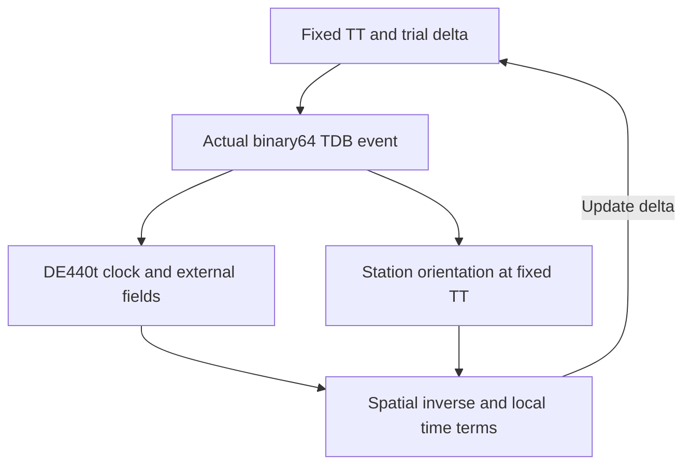

# Mission 45 — Coupled Relativistic Site-Clock Model and Reference Qualification

## Outcome and qualification

All 48 historical site cases and 12 geocentric controls converge and pass the
declared coupled-model numerical checks. Space and time are evaluated together
at each recorded trial event. The model includes explicit TT/TCG and TDB/TCB
scaling, the Mission 44 spatial polynomial, and the local c^-4 time polynomial
with ten-body Newtonian coefficients.

This closes the numerical coupling gap **within the declared quantized model**.
It does not establish a continuous-equation root error bound or a complete
physical clock reference. Physical site-clock and arrival bounds remain `null`;
all 288 combined arrival cases remain blocked. The selected research arrival
convention remains `astroscope-tdb-solar-au-v1`, and production code is unchanged.

The change from Mission 43 is −0.03942 to +0.04137 ps. The live Astropy clock
minus this reference remains −27.0662 to −22.9410 ns. These signed model
differences do not establish which clock is physically more accurate.

## Baseline and protocol freeze

Mission 44 merged through [PR #44](https://github.com/wolfchil345/astroscope-ai-observatory/pull/44)
at `c7bbcc54425ef9a2dc02550c45b94797bdb76bcf` on 2026-10-18 at 14:56:18 UTC.
Its [post-merge Quality Gate](https://github.com/wolfchil345/astroscope-ai-observatory/actions/runs/39138219738)
passed before Mission 45 tracked changes began.

Commit `0bae31a` froze the [policy](../../../validation/manifests/coupled_clock_policy_v1.json)
and [reference requirements](../../../validation/reference_generation/coupled-clock-requirements.txt)
before new state evaluations, coupled solves or comparisons. All four historical
dates, four sites and three hours are preserved, with twelve separate zero-site
controls. There is no target-direction multiplication or residual-based exclusion.
Thirteen historical files are checksum-pinned, preserving earlier evidence,
EOP/leap tables, source convention and production timing code.

| Frozen numerical check | Limit |
|---|---:|
| Fixed-point iterations | 8 |
| Spatial updates per event | 4 |
| Clock equation residual | 1e-18 s |
| Independent offset and local-term comparison | 2e-18 s |
| Spatial replay L1 discrepancy | 2e-8 m |
| Coefficient replay | 5e-14 relative + 1e-25 absolute, per scalar |
| Same-kernel clock reader agreement | 1e-12 s |
| Same-kernel Earth velocity reader L1 agreement | 1e-6 m/s |
| Historical clock reproduction | 1e-12 s |
| Actual ET argument quantization | 1e-7 s |
| Absolute trial TDB−TT offset | 0.01 s |

These limits concern computation and reproduction of supplied data. No physical
accuracy threshold is derived from them. The initial numerical failure described
below was repaired without changing any threshold or input selection.

## Coupled coordinate model

Let `T` be TCG, `t` be TCB, and `r=x_station(t)−x_E(t)`. The IAU B1.3 local
time difference at a common barycentric event [1] is

```text
T_site(t) − T_geocentre(t)
  = −v·r/c² + [B_i r_i + B_ij r_i r_j + C(t,r)]/c⁴
```

The geocentric time function is already represented by the DE440t time segment,
`D(TDB)=TT_geocentre(TDB)−TDB`. Subtracting at the same event and applying
`F_G=1−L_G` gives the implemented site shift:

```text
S = F_G [v·r/c² − (B·r + rᵀ B_matrix r + C)/c⁴]
delta = TDB − TT_site
delta + D(TT_site + delta) − S(TT_site, TT_site + delta) = 0
```

No geocentric integral or normalization is added twice. The site terms are
derived from the general B1.3 polynomial, rather than identifying the shorter
practical station expression in Park et al. [3] with all of these terms.
The experiment maps coordinate times; it does not solve a station proper clock.

The nominal WGS84 rotated vector is explicitly assumed TT-compatible. With
`F_B=1−L_B`, `L_B=1.550519768e-8` and `L_G=6.969290134e-10`, solve

```text
X = X_TT/F_G
r + [v(v·r)/2 + W r + r(a·r) − a(r·r)/2]/c² = X
r_TDB = F_B r
```

The four spatial fixed-point updates follow Mission 44. Nominal WGS84 coordinates
remain an assumption, not surveyed ITRF evidence. The scale relations follow [2]:
velocities and `GM/r` are invariant; acceleration scales by `F_B`, potential
spatial gradients and the total time derivative by `F_B`, and jerk by `F_B²`
when converting TDB-compatible coefficients to the TCB-compatible polynomial.



### Local coefficients and assumptions

The ten sources are the Sun, seven non-Earth planetary-system barycentres,
Pluto-system barycentre and Moon: NAIF IDs `10,1,2,4,5,6,7,8,9,301`.
Earth and the Earth-Moon barycentre are excluded. For TDB-compatible
`d=x_body−x_E`, `u=v_body−v_E`, mass parameter `mu`, and radius `rho=|d|`:

```text
W                 = Σ mu/rho
a                 = F_B Σ mu d/rho³
vectorW           = Σ mu v_body/rho
gradVectorW_ij     = F_B Σ mu v_body_i d_j/rho³
dotW              = −F_B Σ mu (d·u)/rho³
jerk              = F_B² Σ mu [u/rho³ − 3d(d·u)/rho⁵]

B_i               = −(v·v)v_i/2 + 4 vectorW_i − 3 v_i W
B_ij              = 2 gradVectorW_ij − v_i a_j + delta_ij dotW/2
C                 = −(r·r)(jerk·r)/10
```

The dot in B1.3 is the **total derivative along Earth**, not the partial
derivative at fixed barycentric position; an analytic test distinguishes them.
The model sets `Q=gradW−a=0` by using the same Newtonian monopole acceleration
and potential gradient. This does not assert that the ten-body acceleration is
the exact derivative of the full DE440 Earth trajectory. Unmodeled bodies,
multipoles, spins, relativistic force corrections and higher orders remain
unbounded physical differences. Consequently the calculation is not a complete
physical realization of the IAU transformation.

## Reference independence and reproducibility boundary

The [generator](../../../validation/reference_generation/coupled_clock.py) uses
CSPICE N0067/SpiceyPy 8.3.0, Skyfield 1.55, jplephem 2.24 and NumPy 2.5.4 in
an isolated environment. It has no Astropy, ERFA, PINT, production or audit-module
imports. The local coefficient calculation and spatial/time equations use
90-digit Decimal component arithmetic. jplephem separately reads the same
kernel's clock and Earth velocity at the actual CSPICE ET; this is reader
agreement, not an independent physical ephemeris.

Source files retain the Mission 44 identity:

| Source | Bytes | SHA-256 |
|---|---:|---|
| JPL `de440t.bsp` [5] | 152747008 | `4f003b4437a8b479aaca262716a779e3683413200adfd6353c4901aab5de800e` |
| NAIF `gm_de440.tpc` [6] | 12406 | `924ddf4fb9ead9fe8a1aa55780bcabde40b09d00065d58226e24b68d8092f140` |

At every iteration the generator records the raw states, independent local
reference result, requested offset, actual binary64 ET and argument error.
Skyfield retains the fixed TT and frozen EOP/leap data while receiving that same
actual TDB event explicitly; its approximate TDB−TT fallback raises if called.
Observed dX/dY corrections remain unapplied as in Mission 43.

The live [audit](../../../validation/coupled_clock.py) independently evaluates
the coefficients with NumPy arrays, then solves the clock using binary64
spatial/time arithmetic. Its ordinary offline state provider is the archived
table keyed by exact actual ET. Missing events fail explicitly: there is no
interpolation or implicit reuse of a neighboring state. Thus the offline replay
tests the supplied numerical problem, not general ephemeris evaluation at
arbitrary dates. Analytic affine-clock providers test solver behavior outside
the archived event table. Live Astropy site clocks are evaluated separately
under the earlier frozen-table context and checked against historical records.

The largest recorded ET argument error is 5.95921e-8 s. This is quantization of
the ephemeris argument, not direct rounding of the separately stored TDB−TT
offset. A small residual of this quantized state provider is not a proof of an
equally small continuous-equation error. The continuous-root bound remains null.

### Retained numerical failure and repair

The [initial failed development record](../../../validation/results/coupled_clock_development_failure.json)
contains all 48 site rows and 12 controls, with 46 site rows passing. Two
`B_matrix[1,2]` checks failed for Tokyo and Paranal on 2024-09-22 at 12 UTC.
Subtracting larger binary64 coefficient contributions gave relative errors
6.195e-14 and 5.560e-14 against the frozen 5e-14 limit. Clock-offset comparisons
already passed. The record includes the hash of the then-uncommitted audit source
and is explicitly developmental, rather than a clean canonical run.

The repair reads source decimal strings into NumPy `longdouble` and preserves
guard bits throughout coefficient calculation, rounding once to binary64 before
the spatial inverse and clock solve. At least 64 significand bits are required;
platforms whose `longdouble` is only binary64 fail with an explicit diagnostic.
Linux local/CI environments meet this requirement, and the actual bit count is
recorded. Thresholds, reference values and case selection are unchanged. Exact
zero Decimal values were also serialized canonically as `0`, avoiding irrelevant
large zero exponents in the reference artifact.

## Measured results

All 60 reference solves converged; all 48 site and 12 control numerical checks
pass after the precision repair. Each historical site solve takes three
iterations. All results remain in the artifact, including signed differences.

| Diagnostic over 48 site cases | Minimum | Maximum |
|---|---:|---:|
| Live Astropy minus coupled model, ns | −27.06616 | −22.94102 |
| Coupled model minus Mission 43, ps | −0.0394117 | +0.0413611 |
| Total local c^-4 contribution, ps | −0.0690342 | +0.0724411 |
| Linear c^-4 contribution, s | −6.90344e-14 | +7.24413e-14 |
| Quadratic c^-4 contribution, s | −3.75839e-19 | +4.43453e-19 |
| Cubic c^-4 contribution, s | −3.63080e-24 | +3.60087e-24 |
| Independent offset replay difference, s | −1.70555e-19 | +1.50249e-19 |

The tiny quadratic/cubic terms require dedicated analytic coefficient and
contraction tests: a whole-clock tolerance alone would not detect their omission.
Five larger faulty mappings—omitted c^-4 terms, reversed c^-4 sign, omitted
`F_G`, duplicate geocentric clock and legacy untransformed vector—are each
rejected for all 48 historical site rows. Failed solver/provider outcomes remain
visible rather than being excluded from the inventory.

## Physical evidence gate

| Evidence | Supported use | Unresolved limitation |
|---|---|---|
| IAU B1.3 [1] | Structure and signs of the local coordinate transformation | Truncation and physical input errors are not quantified here |
| Relativistic scaling [2] | Coordinate, mass and derivative scale relations | No station survey or ephemeris uncertainty follows |
| DE440 formulation [3] | Integrated geocentric clock and ephemeris provenance | No applicable complete site-clock hard bound established |
| IAU B1.5 note 1 [4] | Conditional published formulation accuracy | The 0.2 ps statement cannot be transferred to this truncated ten-body realization |

Six components remain open: geocentric time ephemeris, Earth state, station
coordinates, Earth orientation, omitted physics/coefficient-model consistency,
and higher-order remainder. Formal EOP errors, reader agreement, numerical
convergence and the measured model differences are not substituted for those
missing bounds. Combined inventory remains 288 candidates, 0 executed,
288 blocked, 240 solar-domain eligible and 48 solar-domain excluded.

Primary sources [1–4] were inspected on 2026-10-18 UTC. The IERS Chapter 10 PDF
endpoint did not load during this mission; no new access or finding from that
endpoint is claimed. Earlier mission evidence is preserved.

## Offline reproduction and tests

Normal execution uses checked-in derived states and existing project packages;
it requires no raw kernel, Skyfield or SpiceyPy. Use Linux with NumPy extended
precision of at least 64 significand bits.

```bash
python -m validation.coupled_clock --output /tmp/coupled_clock_reference_run.json
python -m pytest -q tests/validation/test_coupled_clock.py
```

For independent regeneration, provision the checksum-pinned files [5, 6] and
install the pinned generator requirements before the offline run:

```bash
python -m venv /tmp/coupled-clock-reference
/tmp/coupled-clock-reference/bin/pip install -r validation/reference_generation/coupled-clock-requirements.txt
/tmp/coupled-clock-reference/bin/python -m validation.reference_generation.coupled_clock \
  --kernel /path/to/de440t.bsp --gm-source /path/to/gm_de440.tpc \
  --output /tmp/coupled_clock_v1.json
cmp validation/fixtures/coupled_clock_v1.json /tmp/coupled_clock_v1.json
```

Independent regeneration was byte-identical. The 59 new tests cover analytic
point-mass coefficients, total-versus-partial derivatives, exact rational time
terms, rotation covariance, a closed-form spatial limit, affine clock roots,
nonconvergence, missing/wrong events, deliberate mapping faults, provenance,
qualification gates, precision failure, cancellation regression and offline CLI
execution. All **3365 tests passed**; Ruff lint, formatting of the three new
Python files, compilation and internal document links passed. Scientific fields
also match across NumPy 2.5.3/Astropy 8.0.1 and NumPy 2.5.4/Astropy 8.0.2.
The [canonical record](../../../validation/results/coupled_clock_reference_run.json)
was generated from clean implementation commit
`fb4f1da4bfaa95912f292f8b8920a970b28e9653`, with Python 3.12.14,
NumPy 2.5.3, Astropy 8.0.1, PyERFA 2.0.1.5 and 64 coefficient guard significand
bits. CI preserves all thirteen earlier artifacts and adds
`coupled-site-clock-record`.

## Next research boundary

Proposed Mission 46: **Time-Ephemeris Normalization and Physical Uncertainty
Evidence**, pending Mission 45 review and merge. It should investigate the
remaining geocentric/reference evidence and normalization conventions without
fitting away the observed offset or claiming an unsupported total uncertainty.
Mission 46 is not started here.

## Primary references

1. [Soffel et al. (2003), IAU 2000 reference systems](https://arxiv.org/pdf/astro-ph/0303376), Appendix A, B1.3, printed p. 35.
2. [Klioner (2008), relativistic scaling](https://arxiv.org/pdf/astro-ph/0508292), Eqs. 7–9, 23–25 and derivative implications.
3. [Park et al. (2021), DE440 and DE441](https://ssd.jpl.nasa.gov/doc/Park.2021.AJ.DE440.pdf), §2.3.
4. [IAU 2000 resolutions](https://syrte.obspm.fr/IAU_resolutions/Resol-UAI.htm), B1.5 note 1.
5. [JPL DE440t SPK](https://ssd.jpl.nasa.gov/ftp/eph/planets/bsp/de440t.bsp).
6. [NAIF DE440 GMs](https://naif.jpl.nasa.gov/pub/naif/generic_kernels/pck/gm_de440.tpc).
