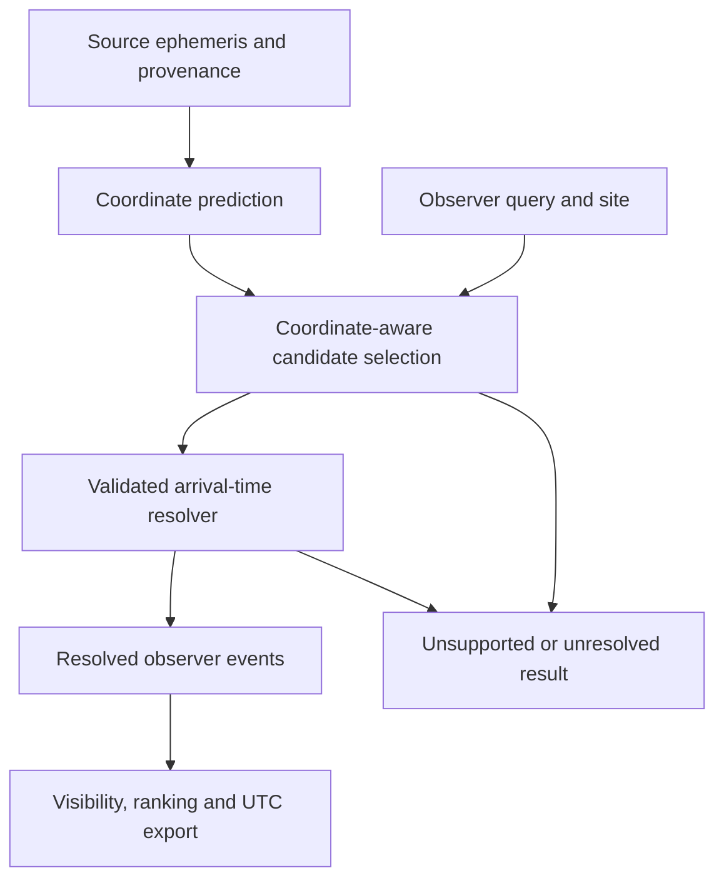

# Mission 36 — Transit Time-Coordinate and Uncertainty Contract

## Scope and baseline

**Design and current-behavior audit only. No new timing accuracy is established.**

Mission 35 merged through [PR #35](https://github.com/wolfchil345/astroscope-ai-observatory/pull/35)
at `1a5e09612662d1756289dfe45465233fb6f0153d` on 2026-10-17 at 15:00:04 UTC.
Its pre-merge quality gate passed 2,787 tests and six benchmark jobs.
The merge tree equals the reviewed head `1c0332e5b66371e4ab56ddbf8c3dd4cb67da583c`.
The merge was a squash: the original policy and implementation commits are
provenance references from the PR branch, not ancestors of the new main commit.
Do not rewrite Mission 35's canonical implementation hash or measured record.

Mission 35 explicitly requires a time-coordinate and boundary contract before
stronger downstream claims. This is the next scoped Phase 2 task, following the
[Mission 28 design-before-implementation pattern](civil_time_interval_semantics.md).
It does not close Phase 2 or begin optimisation, catalogue ingestion, or a new UI.

The [contract manifest](../../../validation/manifests/transit_time_contract_v1.json)
contains prospective acceptance scenarios, all marked `not_executed`.
The [audit record](../evidence/transit_time_contract_audit_v1.json) records existing
behavior and source hashes. Neither artifact is a conversion benchmark or a
pass certificate for the proposed contract.

## Independent references and project decisions

| Reference | Scientific basis used here | Boundary |
|---|---|---|
| [Eastman, Siverd & Gaudi (2010)](https://arxiv.org/abs/1005.4415), PASP 122, 935, DOI 10.1086/655938 | A timestamp needs a time standard and a reference location; barycentric timing is not an observing clock reading | No precision claim from that paper transfers to AstroScope |
| [Astropy Time documentation](https://docs.astropy.org/en/stable/time/index.html#barycentric-and-heliocentric-light-travel-time-corrections), observed version 8.0.2 | A light-time correction uses target direction and observer location; the example adds that correction to TDB. Time-scale conversion alone is insufficient. UTC days need not contain 86,400 seconds | Implementation guidance, not an independent oracle if a future adapter uses Astropy |
| [NASA Exoplanet Archive PS/PSCompPars columns](https://exoplanetarchive.ipac.caltech.edu/docs/API_PS_columns.html) | `pl_tranmid`, its error/limit fields and source reference must accompany the appropriate time-system metadata: `pl_tsystemref` in PS; `pl_tranmid_systemref` in PSCompPars | Column documentation, not a captured catalogue row or assurance that every row is complete |
| [NIST uncertainty propagation](https://physics.nist.gov/cuu/Uncertainty/combination.html) | Covariance contributes to propagation; omitting it requires an explicit uncorrelated-input assumption | Does not establish a Gaussian distribution, a confidence interval, or observational coverage |

Sources were inspected on 2026-10-17 UTC (2026-10-18 JST). Links and paraphrased
support are recorded in the manifest; external pages are not archived here.
The proposed field names, rejection policies, staged migration and acceptance
scenarios below are **AstroScope design decisions**, not requirements attributed
to those sources. All information needed to review this design is local; a future
numerical reference dataset still needs independently archived inputs.

## Audited paths and observed consequences

| Path and symbol | Current behavior at the baseline | Consequence |
|---|---|---|
| `transit_scheduler.TransitEphemeris` / `TransitEvent` | Floating JD and optional uncertainty inputs; no scale, position, source, validity, or covariance fields | Numerically identical dates with different meanings cannot be distinguished |
| `calculate_timing_uncertainty_days` | Each `None` is replaced by zero | Missing evidence can produce an apparently exact prediction |
| `build_transit_event` | Symmetric contacts and baseline/uncertainty padding are all formed by arithmetic in the same JD coordinate | Coordinate durations and elapsed observing durations are not separated |
| `transit_schedule_application.build_schedule_request` | UTC dates become JD floats, ending at `time.max` | Endpoint precision can be lost on conversion to a single float |
| `transit_schedule.generate_transit_schedule` | The same request numbers select cycles before visibility analysis | A UTC query can be compared directly with a BJD ephemeris |
| `transit_visibility.sample_transit_visibility` | `Time(value, format="jd", scale="utc")` | A supplied BJD/HJD value is interpreted as UTC without resolving its origin |
| `transit_schedule_exports` / `transit_schedule_visuals` | JD floats become UTC-labelled timestamps and timeline positions | Syntactically valid exports are not evidence of valid observing times |
| `transit_ranking.score_timing_confidence` | `exp(-uncertainty_hours / 2)` | Zero from missing inputs receives the maximum timing component, 1 |
| `transit_schedule_dashboard` / `build_schedule_target` | Numeric uncertainties, no unknown-state selector or time-coordinate controls | UI input cannot preserve these distinctions |
| `exoplanet_catalog.build_exoplanet_adql` | Selects `pl_orbper`, but not `pl_tranmid` or its time-system fields | There is no demonstrated automatic catalogue-to-scheduler ephemeris pipeline; do not invent one |

These are code-path findings, not measurements of actual sky-timing errors.
The audit's synthetic epoch `2451545.0` exports as `2000-01-01T12:00:00Z`.
That shows the UTC interpretation only; it is not a BJD-to-UTC reference pair.
Both missing uncertainties and both explicit zeros yield sigma 0 and timing
score 1 for cycles 0 and 10. At cycle 10, a missing epoch error with period
error 0.001 days yields 0.01 days; the missing contribution remains unknown.
A known epoch error with missing period error is sufficient at cycle 0, where
the period's coefficient is zero, but not at nonzero cycles.

## Required domain distinctions

A future strict boundary must carry these separate values:

| Value | Required content |
|---|---|
| Source ephemeris | Source ID, parameter-set identity, retrieval/version evidence, original numeric strings and units, epoch, period, valid cycle/time interval or explicit unknown validity |
| Time coordinate | Representation (JD/MJD/offset and explicit zero point), scale (e.g. TDB/TAI/UTC), reference position (barycentric/heliocentric/observer/geocentric/unknown), original label |
| Observer context | Site geodetic coordinates and datum, target ICRS coordinates, reference epoch and motion assumptions, conversion/data versions and coverage |
| Uncertainty | Known/unknown state per component, value and unit when known, symmetry and confidence interpretation, covariance value or explicit assumption and source |
| Duration | T14 definition, unit, coordinate or elapsed-time basis, uncertainty state, and symmetric-contact approximation flag |
| Coordinate prediction | Cycle ID and midpoint/contacts in the declared ephemeris coordinate, with assumptions; never an implicit UTC instant |
| Resolved observation | Actual observer arrival instants, original prediction, conversion evidence, and separate SI-elapsed observing margins |

Do not accept BJD as an Astropy `format` or as a time scale. It describes a
reference-position correction in addition to a time scale and date
representation. `JD`, `HJD` or `BJD` alone is insufficient. A floating number's
magnitude cannot supply missing metadata. Preserve source strings; never improve
claimed input precision merely by storing them in a two-part representation.

The initial strict implementation should support declared barycentric TDB
**arithmetic** and explicitly declared observer-arrival arithmetic on a uniform
TAI interval basis. A UTC epoch may be an input representation for the latter
only when its period basis and observer meaning are independently declared; it
must be converted as an instant before adding uniform durations. This does not
make a published constant BJD period a constant observer-arrival period.
Other complete coordinates may be retained as source records but remain
unsupported for strict prediction until their arithmetic semantics are specified.
Unknown coordinates are available only through the explicitly labelled legacy
arithmetic path. No legacy result is automatically promoted into a strict one.

## Resolution and query contract



The strict scheduler, visibility path, UTC timeline and calendar export must
consume resolved observer events. They must reject unresolved coordinate
predictions through structured reasons rather than relabelling their values.
An arithmetic preview may retain unresolved predictions and original units.

For a future BJD TDB resolver, the conceptual forward relation is

\[
B = \operatorname{JD}_{\rm TDB}(t_{\rm obs})
    + \Delta_{\rm light}(t_{\rm obs},\hat{s},r_{\rm obs},\mathcal E).
\]

This is a contract sketch, not a complete relativistic correction algorithm.
The chosen model must explicitly state included and omitted correction terms.
Given B, the resolver must solve for the observing instant; simply constructing
`Time(B, scale="tdb").utc` omits the light-time inversion. Any iterative method
needs a frozen stopping criterion, bounded iteration count, finite-value checks,
and explicit nonconvergence rejection. A forward/inverse round trip is necessary
but cannot establish independence or physical accuracy by itself.

Site, target, time-scale data, ephemeris coverage and relevant coordinate-motion
assumptions are mandatory. Missing or incompatible metadata rejects. HJD is not
silently treated as BJD. A conversion already applied must be identified so it
cannot be applied twice. Converting a midpoint does not authorize applying the
same correction to every contact and padded endpoint without an error bound.

A query must declare its coordinate and inclusion policy. A source-coordinate
arithmetic query may select midpoint cycles in that same coordinate. An observing
query uses resolved arrival midpoints. Candidate generation must either transform
the query boundaries under a proven monotonic mapping on the interval, or use a
conservative, documented enclosing range; final membership is checked in observer
instants. No guessed fixed light-time margin or silent pruning is permitted.

The low-level source-coordinate policy remains closed `[start, end]`, including
an exact point interval. A future whole-calendar-date UI should translate its
selected dates to `[start midnight, midnight after the last date)` using resolved
instants, not `23:59:59.999999` rounded to one JD float. Preserve that difference
in the request schema and tests; do not silently change legacy inclusion.

Comparison must retain original decimal precision or two-part time values until
the last display step. Distinguish representational precision, numerical solver
error and physical uncertainty. Membership within a declared numerical error
bound is `boundary_indeterminate`, with candidate and reason retained; it is not
an eligible pass or a silent empty result. Mission 35's 0.2 ms arithmetic bound
must not become a universal conversion tolerance or a boundary-shifting epsilon.

Contacts are first generated in their declared duration basis. Observer baselines
are then applied as SI-elapsed intervals to resolved contacts. Nonzero timing
uncertainty must be propagated through the resolver or bounded conservatively
with a declared method, not copied as a calibrated observer uncertainty. Leap
seconds require a continuous internal time scale for elapsed arithmetic. Formats
that cannot represent an instant (including Python datetime at a leap second)
must return an explicit export error, not silently shift it.

## Uncertainty and ranking contract

For a linear ephemeris with symmetric standard uncertainties,

\[
\sigma_T^2(n)=\sigma_{T_0}^2+n^2\sigma_P^2+2n\,\operatorname{Cov}(T_0,P).
\]

Covariance has units of days squared when both inputs use days. Signed cycles
matter. Validate finite nonnegative marginal variances and a positive
semidefinite covariance matrix. Do not silently clamp an invalid matrix into
validity; any allowance for numeric roundoff needs a predeclared bound.

- **Unknown is distinct from zero.** Missing contributing uncertainty returns
  unknown (`null` plus reason), not zero or a partial total labelled complete.
- At cycle 0, period and covariance terms vanish: known epoch uncertainty is
  sufficient. At other cycles, absent covariance stays unknown unless an
  explicit zero-covariance assumption is selected and retained in provenance.
- Explicit zero is a supplied model value, not proof of a perfectly known real
  event. Keep its source/assumption. Partial known components can be reported
  separately without being presented as total uncertainty.
- Asymmetric limits, upper bounds, posterior quantiles and standard deviations
  are distinct. Retain original values; do not average asymmetric errors or
  interpret a catalogue limit as a one-sigma measurement.
- A source period and epoch from unrelated fits have no established joint
  covariance. Preserve their separate references and reject claims requiring
  a joint fit until an explicit scientifically justified model is supplied.
- Nominal arithmetic may proceed with unknown uncertainty and a clear status.
  A requested nonzero sigma-based padding cannot be fulfilled with unknown
  contributing uncertainty. The first strict scheduled/ranked workflow should
  reject that request; a nominal preview must remain visibly unquantified.
- Unknown timing uncertainty cannot enter `score_timing_confidence` as zero.
  Initially exclude it from automatic confidence-ranked schedules and disclose
  the exclusion. Future missing-score handling requires its own ranking policy;
  it must not silently reweight other terms or imply calibration.
- Known uncertainties and explicit zero covariance still do not establish
  confidence coverage, fit validity, absence of TTV/decay, or long-range accuracy.
  Validity limits are independent of the magnitude of a propagated sigma.

## Persistence, compatibility and implementation sequence

A future schema must store both source coordinate values and resolved observer
instants, conversion provenance, uncertainty states and assumptions, duration
basis, query policy and rejection reasons. JSON unknown values are `null`, never
NaN. CSV needs separate status/unit columns; an empty uncertainty cell needs an
explanation. UTC-labelled CSV/calendar fields require resolved instants. A
schema-v1 schedule cannot be upgraded by assuming its existing UTC label proves
source provenance. Keep it readable as legacy output and require explicit
metadata to recompute a strict result. No persisted file is changed in Mission 36.

At Mission 36, the implementation order below was proposed. The bounded first
stage is now implemented for review in [Mission 37](strict_transit_timing_boundary.md);
conversion and subsequent visibility evidence remain unstarted. The original
prospective manifest and historical audit are preserved.

1. **Mission 37 — Strict Transit Timing Metadata and Eligibility Boundary:**
   introduce immutable metadata/uncertainty types, structured rejection, nominal
   arithmetic, explicit legacy adapters, and downstream gating. Test public APIs,
   direct visibility/export bypasses, UI state and all supported languages.
   Reject unresolved BJD/HJD scheduling. Do not enable a new light-time converter.
2. **Subsequent conversion-evidence mission:** freeze an independent reference
   protocol and tolerances before measuring; implement and validate a bounded
   observer-arrival resolver, then enable only the validated domain. Exact scope
   and mission number depend on Mission 37 findings.
3. **Subsequent visibility evidence:** sample sensitivity, horizon/refraction and
   darkness checks must consume resolved times. Mission 35 arithmetic success is
   not a visibility-validation result.

Keep the existing scalar API available for explicitly unvalidated arithmetic
compatibility. Do not make silent global changes to `None`, time scales or cycle
inclusion. Migration documentation must explain any strict-scheduler rejection
of formerly accepted inputs. No implementation should duplicate an old unsafe
path behind new metadata labels.

## Prospective validation gates

The manifest lists scenario IDs and required outcomes, **not executed tests**.
Before accepting future numerical results, freeze the fixture domain, units,
source licences, archived inputs/checksums, source version, independent generator,
random seeds if used, tolerances, sampling policies and exclusion denominators.

- Use analytic fixtures for metadata rejection, known/unknown uncertainty,
  covariance at signed cycles, invalid covariance, exact dyadic membership,
  duration and padding semantics. Derive expected values independently of the
  production implementation.
- For conversion, use independently generated published/reference timing pairs
  with target, site, motion assumptions, correction model and ephemeris specified.
  If production uses Astropy/ERFA, an Astropy-generated expected value is a
  consistency check, not an independent oracle. Shared kernels and algorithms
  must be disclosed even when the wrapper library differs.
- Include both correction signs, multiple sites/sky directions/seasons, dates
  around a leap second, double-correction traps, unsupported coordinates,
  out-of-range ephemerides, missing motion information and solver nonconvergence.
- Query tests need converted-boundary membership, point/half-open/closed cases,
  sub-ULP differences, and no missing or duplicate cycles after conversion.
- Mutation checks must detect a wrong correction sign, pure scale conversion,
  omitted site, unknown-to-zero substitution and lost metadata at export.
- Run with network disabled and pinned leap-second/IERS/ephemeris data. Record
  software/data versions, implementation and checkout commits, input/output
  checksums and coverage limits. Data absent or outside coverage must reject.
- Keep regression, numerical conversion accuracy and observed-transit accuracy
  separate. A physical timing claim additionally requires independently sourced
  observed transits with documented timestamp provenance and an O-C protocol.

Mission 36 freezes no numerical conversion tolerance: no converter or independent
conversion corpus is under test. Selecting tolerances is a prerequisite of the
later evidence mission, not a value to infer from its measured residuals.

## Offline audit reproduction and acceptance

The audit record includes the exact command body used to collect its structural
and synthetic observations, the baseline commit, environment and source hashes.
It blocks socket connections and disables Astropy automatic IERS downloads.
The source hashes must match before reproducing the record at a different head.
No IERS table, sky geometry, catalogue query or barycentric conversion is used.
The small numeric observations characterize the existing code and require no
scientific tolerance; they are not new independent numerical reference values.

For the audit environment, use Mission 35's pinned
[requirements](../../../validation/requirements-transit.txt); compare the
record's dependency versions and observations, allowing environment metadata to
differ. From the repository root, execute the recorded body with:

```sh
.venv-validation/bin/python - <<'PY'
import json
from pathlib import Path
p = Path('docs/research/evidence/transit_time_contract_audit_v1.json')
record = json.loads(p.read_text())
exec(compile(record['reproduction_python'], str(p), 'exec'))
PY
```

Acceptance is design readiness: reconciled Mission 35 status, an attributable
workflow audit, explicit domain/uncertainty/query/export/compatibility contracts,
a machine-readable future scenario list, independent-reference requirements and
an implementation split. This mission adds **zero production tests**, changes
no production code, and leaves all numerical fixtures and canonical benchmark
records intact. Existing Ruff, full-suite and six CI benchmarks remain required.
The PR's checks record results for its exact head. Phase 2 remains active;
Mission 36 merged through PR #36 on 2026-10-17 at 15:18:20 UTC as
`e5a3c70e8aca77ed0132091d3b088eb73e2f1fcf`; its post-merge quality gate passed.

The design was reviewed and merged in
[PR #36](https://github.com/wolfchil345/astroscope-ai-observatory/pull/36).
Its Quality Gate and retained artifacts report verification for each published
head; a green check does not execute the 26 prospective contract scenarios.
